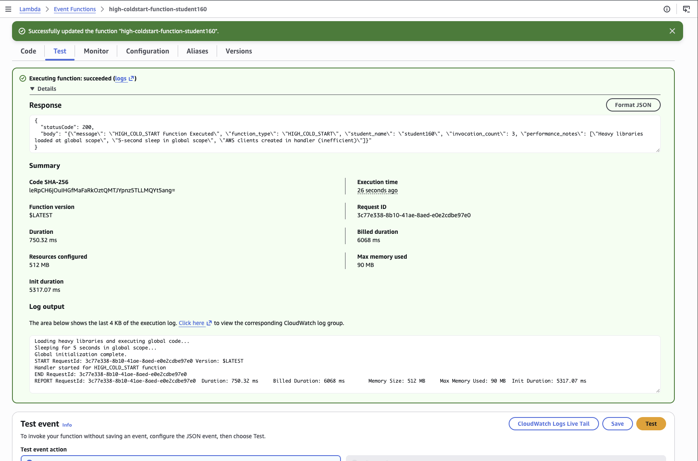
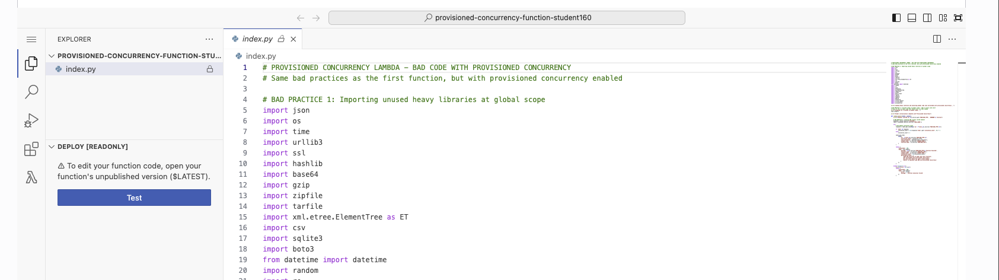
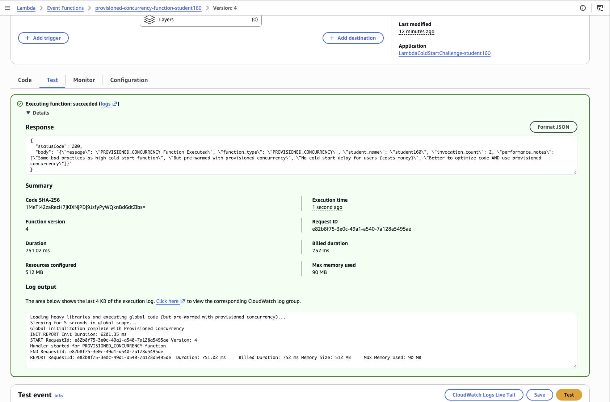
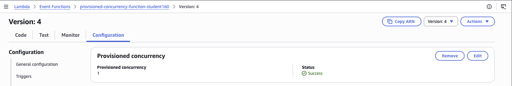
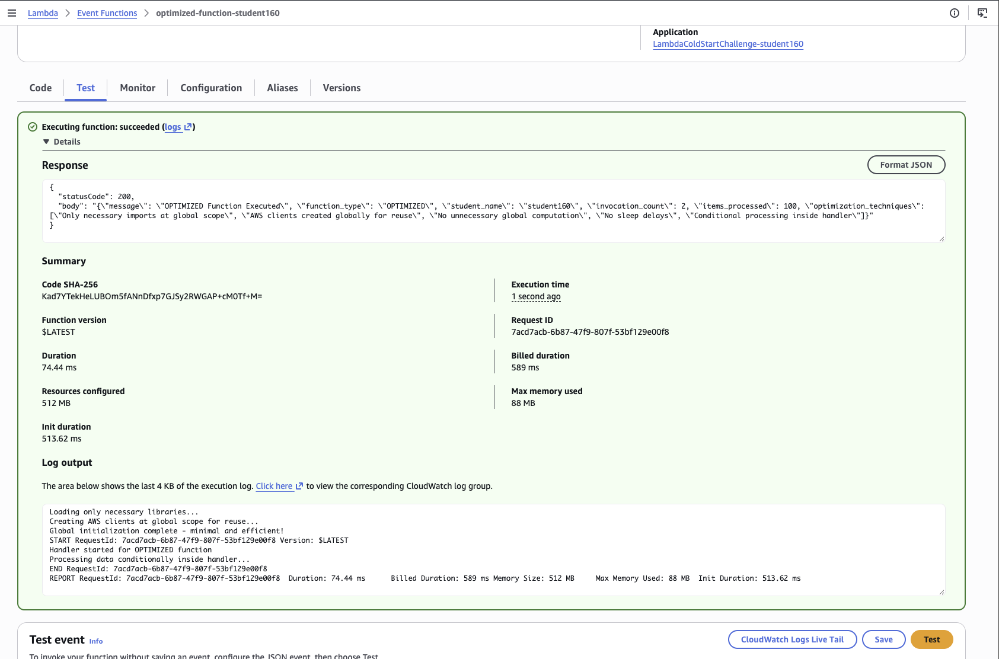
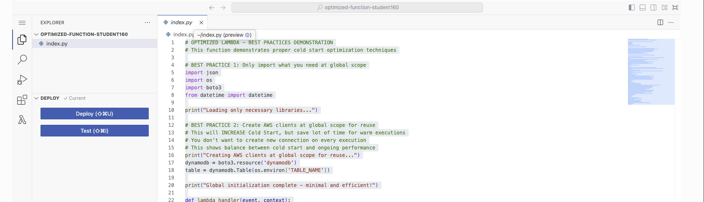
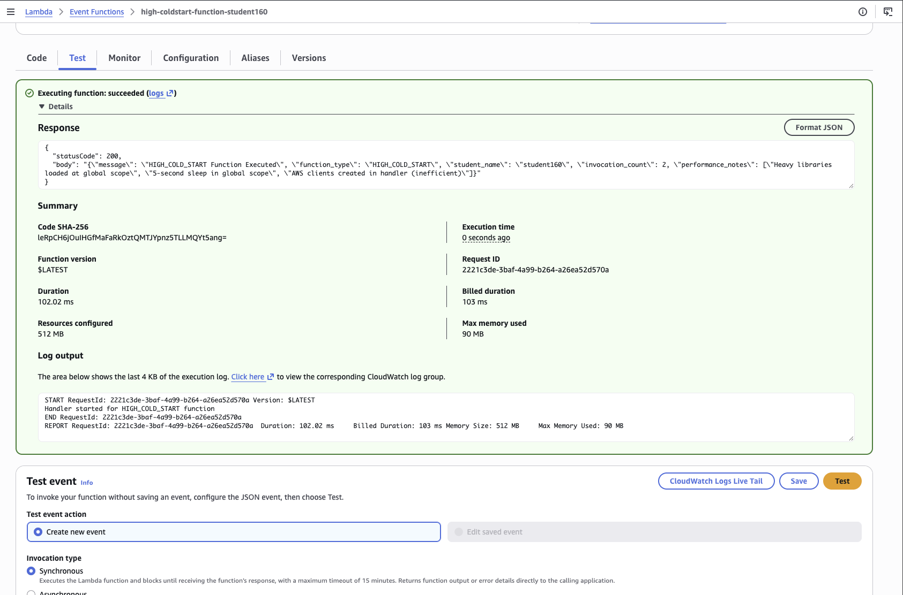

# Lambda Cold Start Optimization

### Objective
Find out why some Lambda functions take seconds to answer their first request, and compare two fixes: paying AWS to keep environments warm (Provisioned Concurrency) and fixing the code itself.

### What I did
In a course lab account with three Lambda functions already deployed, I invoked each one from the console and read its `REPORT` line in CloudWatch Logs. The first function, `high-coldstart-function`, has 31 imports and a 5-second `sleep` at global scope, plus a DynamoDB resource created inside the handler. The second, `provisioned-concurrency-function`, runs the same bad code but has Provisioned Concurrency on Version 4. The third, `optimized-function`, has the code fixed. I compared the **Init Duration** (cold start) and **Duration** (handler time) of all three.

### Services I learned
- **AWS Lambda**: the INIT and INVOKE phases, cold vs warm starts, versions, Provisioned Concurrency
- **Amazon CloudWatch Logs**: the `REPORT` line (`Init Duration`, `Duration`, `Billed Duration`, `Max Memory Used`)
- **Amazon DynamoDB**: why SDK clients belong at global scope
- **Python (boto3)**: what import and global-scope code costs at startup

## Result

| | high-coldstart-function | provisioned-concurrency-function (v4) | optimized-function |
|---|---|---|---|
| Init Duration (cold start) | **5,317 ms** | **none** in REPORT (6,201 ms init ran ahead of time) | **514 ms** |
| Duration (handler), cold / warm | 750 ms / 102 ms | 751 ms (first request) | 74 ms (first request) |
| Billed Duration (first request) | 6,068 ms | 752 ms | **589 ms** |
| Code | 30 imports, `sleep(5)`, client in handler | same bad code | 4 imports, client at global scope |
| Extra cost | none | ~$0.43/day per instance (~$13/month) | none |

**Fixing the code cut the cold start from 5,317 ms to 514 ms, about 10 times faster, at no extra cost.** The first request's bill dropped from 6,068 ms to 589 ms, and even the handler ran 10 times faster (750 ms to 74 ms) because the DynamoDB resource was already built during init. Provisioned Concurrency hid the cold start too, but only for the instances I pay to keep warm. A traffic spike past that number still hits the full 5-second init.

## How a cold start works
```
Request arrives, no warm environment available
   │
   ├─ INIT phase (cold start only)  ── shows up as "Init Duration"
   │     download code, start runtime,
   │     run everything OUTSIDE lambda_handler()
   │       • imports
   │       • time.sleep(5)        ← the bad function's 5 seconds
   │       • boto3.resource(...)  ← belongs here: done once, reused
   │
   └─ INVOKE phase (every request)  ── shows up as "Duration"
         run lambda_handler(event, context)
           • boto3.resource(...)  ← bad function rebuilds it every time

Next request within ~5-15 minutes reuses the same environment: INVOKE only.
Provisioned Concurrency runs INIT ahead of time, before any request arrives.
```

## Files
- [`index_before.py`](index_before.py): the bad code, copied from `provisioned-concurrency-function` (the same bad practices as `high-coldstart-function`): 31 imports, a global `time.sleep(5)`, and a DynamoDB resource created inside the handler, which reads and updates an invocation counter in a DynamoDB table
- [`index_after.py`](index_after.py): the optimized code (`optimized-function`)

## Steps
1. **Slow function:** invoked `high-coldstart-function` from the Test tab and read the log output: **Init Duration 5,317 ms**, Duration 750 ms, Billed Duration 6,068 ms. My first test was a warm start (no Init Duration, 102 ms), so I forced a cold start by saving a small configuration change (the description), which makes Lambda replace its environments.
2. **Read the code:** found about 30 unused imports (`ssl`, `sqlite3`, `multiprocessing`, `ftplib`, `smtplib`...), a global `time.sleep(5)`, and `boto3.resource('dynamodb')` inside the handler.
3. **Provisioned Concurrency:** opened `provisioned-concurrency-function`, switched to **Version 4** (the lab text says Version 1, but my stack had only published Version 4) (Provisioned Concurrency can't be set on `$LATEST`), and checked Configuration → Provisioned concurrency: **1** pre-warmed environment, status Success. Then I ran a test. The REPORT line had **no Init Duration** and billed only 752 ms. Above it, an `INIT_REPORT Init Duration: 6201.35 ms` line shows the 5-second sleep did still run, but before my request arrived, while AWS was pre-warming the environment.
4. **Checked `$LATEST`:** the same function on `$LATEST` showed a full cold start, which proved the warm environments belong to the version, not the function.
5. **Optimized function:** invoked `optimized-function` on a cold start: **Init Duration 514 ms**, Duration 74 ms, Billed Duration 589 ms. The log shows "Creating AWS clients at global scope for reuse..." during init.
6. **Warm run:** invoked each function a second time within a few minutes. No Init Duration, because the environment was reused.

## Screenshots

**1. high-coldstart-function cold start: Init Duration 5,317 ms, billed 6,068 ms**


**2. The bad code (`index.py`, same in both slow functions): heavy libraries imported at global scope but never used**


**3. provisioned-concurrency-function Version 4: the 6,201 ms init ran ahead of time (INIT_REPORT), so the request's REPORT line has no Init Duration and bills 752 ms**


**4. Provisioned Concurrency on Version 4: 1 pre-warmed environment, status Success**


**5. optimized-function cold start: Init Duration 514 ms, billed 589 ms**


**6. The optimized code**


**7. high-coldstart-function warm: no Init Duration, 102 ms**


## Well-Architected pillars
- **Performance Efficiency:** global-scope code runs on every cold start, so keep it to what is reused (SDK clients, config) and drop everything else. More memory also means more CPU, which speeds up CPU-bound init work, but it does nothing for a `sleep` or a network wait.
- **Cost Optimization:** Provisioned Concurrency bills for warm environments whether or not they get traffic. Fixing the code was free and helped every new environment, not just the pre-warmed ones.
- **Reliability:** cold starts are worst during traffic spikes, when many new environments start at once. Short init keeps spikes from turning into timeouts.

## What I learned
- **Global scope is the cold start.** Everything outside `lambda_handler()` runs during INIT. A single `time.sleep(5)` there adds 5 seconds to every cold start.
- **Unused imports aren't free.** Each one is loaded and executed at INIT. Only import what the function uses, and load rarely used libraries inside the code path that needs them (lazy loading).
- **SDK clients go outside the handler.** Creating `boto3.resource('dynamodb')` inside the handler rebuilds it on every request, warm or cold. At global scope it costs a little extra once, then every warm request reuses it.
- **Provisioned Concurrency hides bad code, it doesn't fix it.** It removes the cold start for a fixed number of instances, at about $13/month each. Optimize first, then add it only for user-facing paths that need it.
- **The init is billed.** Billed Duration (6,068 ms) was Duration plus Init Duration, so the 5-second sleep cost money on every cold start, not just time.
- **Forcing a cold start:** saving any configuration change replaces the warm environments, so the next test cold starts.
- **Provisioned Concurrency moves the init, it doesn't remove it.** The log still had a 6,201 ms `INIT_REPORT`, but it ran before my request. My request was billed 752 ms instead of 6,068 ms. The warm environment is billed separately, whether or not it gets traffic.
- **It only works on a version or alias.** Testing `$LATEST` still showed the full cold start.
- **SnapStart is another option** for supported runtimes. It snapshots the initialized environment, but it can't be combined with Provisioned Concurrency.
