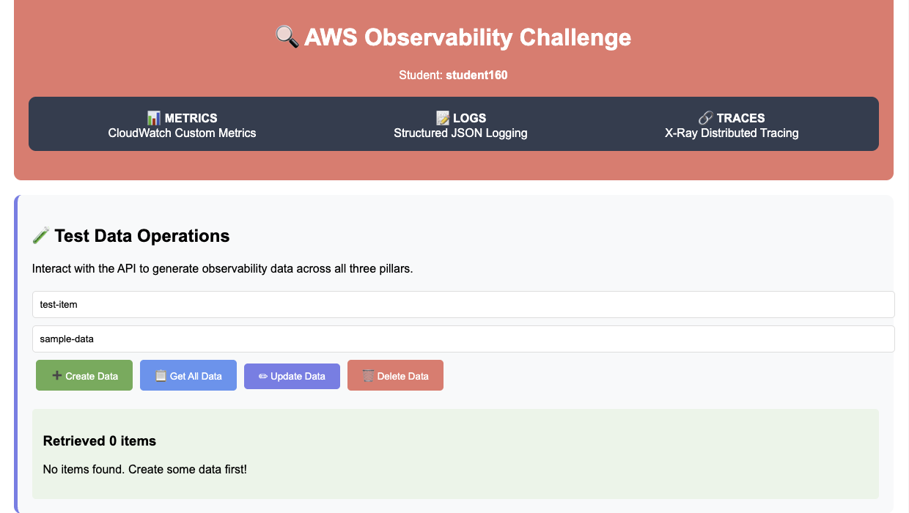
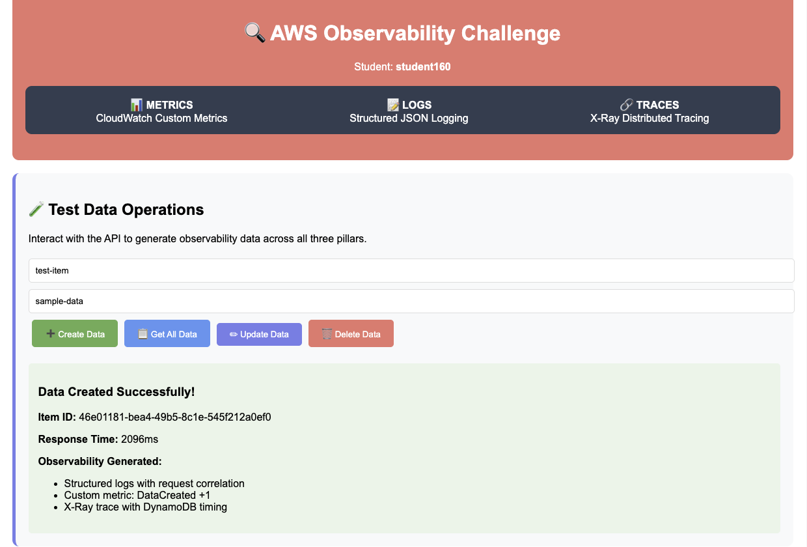
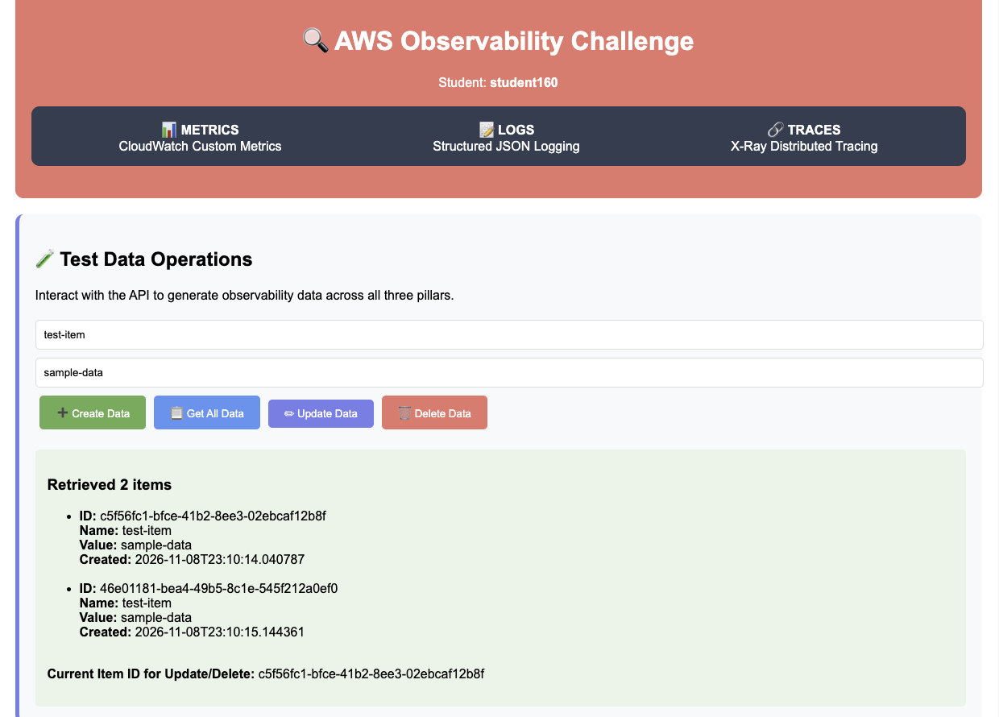
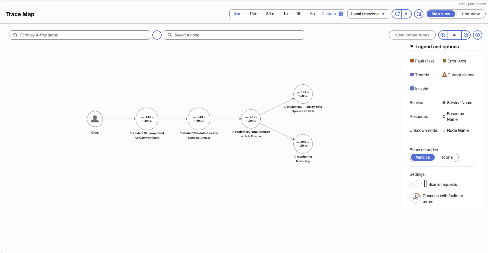
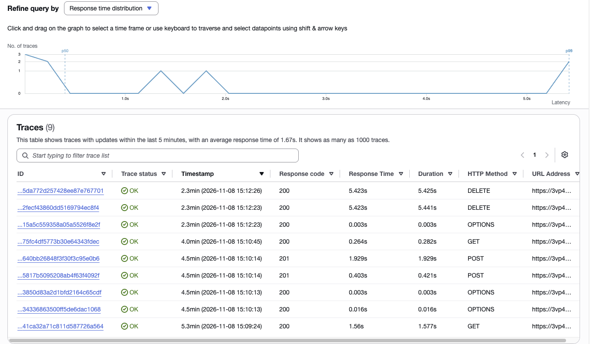
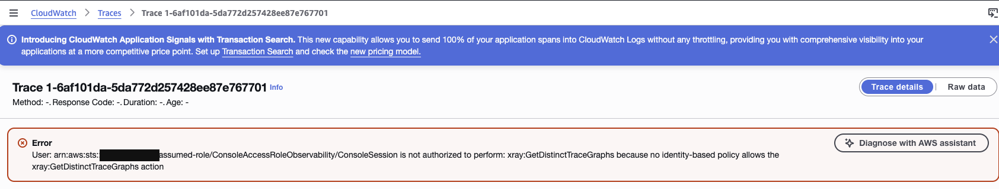
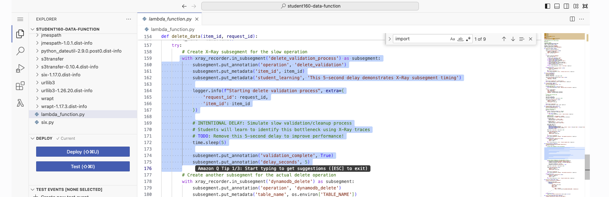
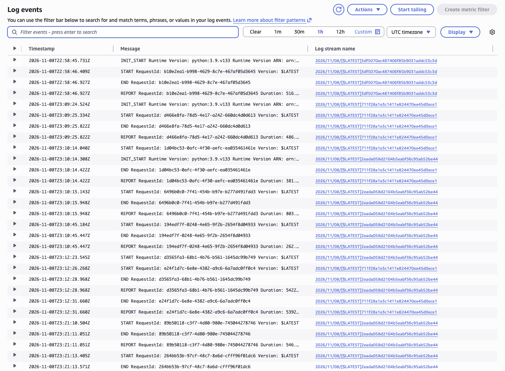
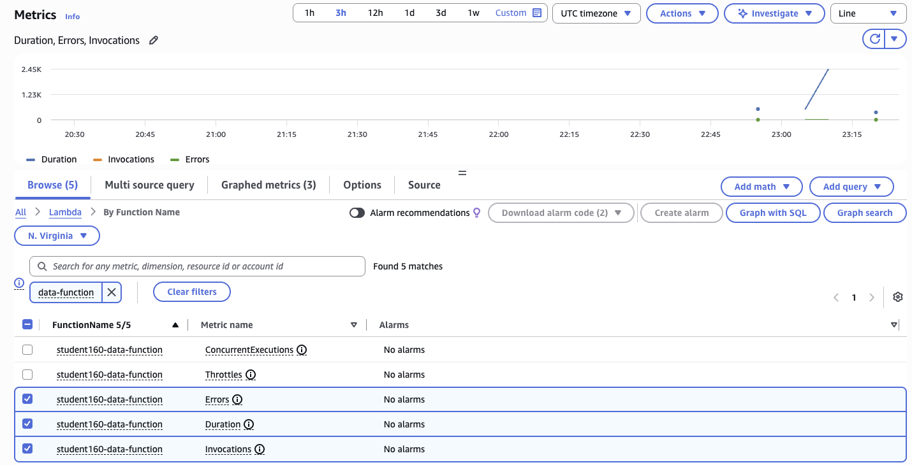
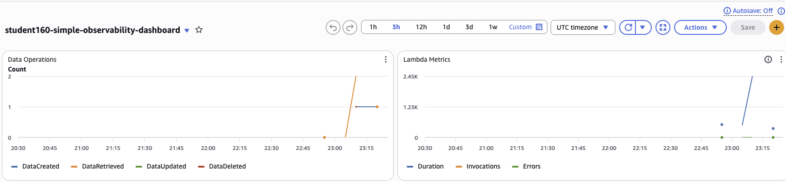

# Observability with X-Ray and CloudWatch

### Objective
Use the three pillars of observability (metrics, logs and traces) to find out why one operation in a serverless API is slow, and learn what each AWS tool can and can't tell you.

### What I did
In a course lab account, a small CRUD app was already deployed: an S3 static website calls API Gateway, which calls a Lambda function (`student160-data-function`, Python 3.9) that reads and writes a DynamoDB table. The function has X-Ray tracing, CloudWatch logging and custom CloudWatch metrics built into the code, plus a hidden 5-second delay in the delete operation. I generated traffic from the website, then used the X-Ray trace map, the trace list, CloudWatch Logs, Lambda's built-in metrics and a custom dashboard to track down the delay.

### Services I learned
- **AWS X-Ray** (now under CloudWatch → Application Signals): trace map, traces, segments, subsegments, annotations and metadata
- **Amazon CloudWatch Logs**: log groups, log streams, the Lambda `INIT_START` / `START` / `END` / `REPORT` lines
- **Amazon CloudWatch Metrics and Dashboards**: built-in Lambda metrics vs custom business metrics (`put_metric_data`)
- **Amazon API Gateway**, **AWS Lambda**, **Amazon DynamoDB**, **Amazon S3** static website hosting

## Architecture
```
Browser (S3 static website)
   │  GET / POST / PUT / DELETE  /data
   ▼
API Gateway (REST, stage prod) ─────────────┐
   ▼                                        │
Lambda student160-data-function             │  every hop sends a segment
   │  X-Ray SDK: patch_all() + subsegments   │  to X-Ray → trace map
   ├──► DynamoDB table (scan, put, update, delete)
   └──► CloudWatch PutMetricData ("monitoring" node)
                                             │
CloudWatch Logs  ◄── logger / REPORT lines   │
CloudWatch Metrics + Dashboard ◄── Invocations, Duration, Errors
                                   + DataCreated, DataRetrieved, DataUpdated, DataDeleted
```

## Result

| Request (from the X-Ray trace list) | Response time | What it shows |
|---|---|---|
| First GET /data | **1.56 s** | Cold start: a new environment (`INIT_START` in the logs) |
| POST /data #1 | 0.403 s | Warm environment |
| POST /data #2 (same second) | **1.929 s** | Second cold start: #1 was still running, so Lambda started a second environment |
| Later GET /data | 0.264 s | Warm |
| OPTIONS (CORS preflight) | 0.003 to 0.016 s | Answered by API Gateway, never reaches Lambda |
| **DELETE /data/{id}** (x2) | **5.423 s** | The bottleneck |

**The trace map pointed at the Lambda function, the trace list isolated the DELETE requests at 5.42 s, and the code showed why: a `time.sleep(5)` wrapped in an X-Ray subsegment called `delete_validation_process`.** The Lambda `REPORT` lines for the same two requests (5,422 ms and 5,392 ms) confirmed that nearly all of that time was spent inside the function, not in API Gateway or DynamoDB (DynamoDB averaged 191 ms on the trace map).

## How I found the bottleneck
1. **Trace map (where?)**: average time per node: API Gateway 1.67 s, Lambda 2.12 to 3.21 s, DynamoDB 191 ms, CloudWatch "monitoring" 212 ms. Lambda is the slow hop.
2. **Trace list (which request?)**: the latency histogram has a cluster near 0 and a spike at 5.4 s (p99). Both spikes are DELETE requests.
3. **Code (why?)**: `delete_data()` wraps a `time.sleep(5)` in `xray_recorder.in_subsegment('delete_validation_process')`, with an annotation `operation = delete_validation` and the `item_id` as metadata.
4. **Logs (which request ID?)**: the `REPORT` line for request `d3565fa3-...` shows Duration 5,422 ms at 23:12:28, matching the 5.423 s trace.
5. **Metrics (is it a pattern?)**: Lambda Duration peaks near 2.45K ms in the 1-minute averages because of the deletes, while Errors stay at 0. It's slow, not broken.

## Files
- [`lambda_function.py`](lambda_function.py): the lab's Lambda code (`student160-data-function`), unchanged. Look for `patch_all()`, `xray_recorder.in_subsegment(...)`, `logger.info(..., extra={...})` and `publish_metric()`.

## Steps
1. **Website (Level 1):** opened the S3 website. **Get All Data** returned "Retrieved 0 items". **Create Data** returned the new item ID with a 2,096 ms response time. **Get All Data** then returned 2 items, because I had clicked Create twice.
2. **Trace map (Level 2):** opened the X-Ray trace map (now in CloudWatch → Trace Map) and turned on **Metrics** under Legend and options to see average latency and requests per minute on each node.
3. **Traces:** listed the traces for the last 5 minutes: 9 traces, average 1.67 s. Spotted the cold starts and the two 5.4 s DELETEs.
4. **Trace details:** clicking a DELETE trace returned **AccessDenied**: the lab's console role lacks `xray:GetDistinctTraceGraphs`, the permission the new CloudWatch trace details page needs. The old X-Ray console URL redirected to the same page. So I confirmed the cause in the Lambda code instead (`time.sleep(5)` on line 172, inside the `delete_validation_process` subsegment).
5. **Logs (Level 3):** opened `/aws/lambda/student160-data-function`. Three log streams (one per execution environment), three `INIT_START` lines (cold starts), and a `REPORT` line per request with its Duration. **The application's own `logger.info()` lines never appeared** (see What I learned).
6. **Built-in metrics (Level 4):** CloudWatch → Metrics → Lambda → By Function Name, filtered on `data-function`: 5 metrics. Graphed Duration, Errors and Invocations.
7. **Custom dashboard:** `student160-simple-observability-dashboard` shows a **Data Operations** widget (custom `Observability/DataApp` metrics) next to a **Lambda Metrics** widget.

## Screenshots

**1. Website: Get All Data before any data, "Retrieved 0 items"**


**2. Create Data: item created, 2,096 ms (a cold start)**


**3. Get All Data: both items returned**


**4. Trace map with metrics: Client → API Gateway → Lambda → DynamoDB and CloudWatch ("monitoring")**


**5. Trace list: two DELETEs at 5.42 s, cold starts at 1.56 s and 1.93 s, warm requests in milliseconds**


**6. Trace details blocked by the lab's IAM role (`xray:GetDistinctTraceGraphs`), account ID redacted**


**7. The cause: `time.sleep(5)` inside the `delete_validation_process` X-Ray subsegment**


**8. Log events: `INIT_START` on each cold start and `REPORT` lines; the DELETE request took 5,422 ms**


**9. Built-in Lambda metrics: Duration, Errors (0) and Invocations**


**10. Custom dashboard: business metrics (DataCreated, DataRetrieved, DataUpdated, DataDeleted) next to Lambda metrics**


## Well-Architected pillars
- **Operational Excellence:** instrument the code so you can answer "what happened to request X?" without guessing. Traces, logs and metrics are part of the design, not an afterthought.
- **Performance Efficiency:** X-Ray subsegments turn "the Lambda is slow" into "this block of code is slow", so you fix the right thing.
- **Reliability:** the Errors metric stayed at 0 while Duration spiked. Alarm on latency (p99), not only on errors, or a slow API looks healthy.
- **Cost Optimization:** custom metrics, X-Ray traces and log storage all cost money. Sample traces, keep log retention short, and publish only the metrics you'll act on.

## What I learned
- **Metrics tell you what, traces tell you where, logs tell you why.** The trace map showed which hop was slow, the trace list showed which requests, and the code and logs showed the cause.
- **Active tracing alone isn't enough for code-level detail.** The Lambda "Active tracing" checkbox shows cold start and total duration. To see which block of code is slow, you import the X-Ray SDK and wrap that block in a subsegment. `patch_all()` also traces every boto3 call, which is why DynamoDB and the CloudWatch `PutMetricData` call ("monitoring") showed up on the map without extra code.
- **Two concurrent requests can mean two cold starts.** I clicked Create twice in the same second. One request went to the warm environment (0.403 s), and Lambda started a second environment for the other (1.929 s). The logs show this as a new log stream with its own `INIT_START`.
- **`logging.basicConfig()` does nothing in Lambda.** The lab code calls `logging.basicConfig(level=logging.INFO)`, but the Python runtime already attaches a handler to the root logger, so the call is ignored and the level stays at WARNING. Every `logger.info()` line, including "Deleted item", was silently dropped. The fix is `logger.setLevel(logging.INFO)`, setting the application log level in the function's logging configuration, or using Powertools for AWS Lambda's Logger. Also, the `extra={...}` fields are only written out with a JSON formatter or Lambda's JSON log format, not with the default text format.
- **The `REPORT` line is your fallback.** Even with no application logs, every request still gets a `REPORT` line with its request ID and Duration, which I matched to the X-Ray trace.
- **Read the custom metric code before trusting the graph.** `DataRetrieved` publishes the number of items returned, not 1 per call, so the graph reached 2 after a single Get All.
- **Observability needs IAM too.** The new trace details page needs `xray:GetDistinctTraceGraphs`. The lab role didn't have it, so the most useful view was blocked. In a real account, check that on-call roles can read traces before an incident.
- **X-Ray isn't only for Lambda.** Any code that runs the SDK (EC2, ECS, EKS, on-premises) can send traces, through the X-Ray daemon or the AWS Distro for OpenTelemetry collector.
