# Custom Domain for an ALB with Route 53

### Objective
Put a custom domain in front of an Application Load Balancer with a Route 53 alias record, prove DNS resolves it, and then lock the load balancer down so it only answers requests for that domain.

### What I did
In a course lab account, an internet-facing Application Load Balancer (`customdomain-alb-lambda-l1`, HTTP:80) was already deployed in front of a "Hello World" Lambda function (Python 3.11), and a Route 53 public hosted zone already existed for `bootcamp-student[X].com`. I tested the ALB on its AWS DNS name, created an apex **A record with Alias** pointing at the ALB, checked the result with `nslookup`, `dig`, a browser and `curl`, and then added a **Host header listener rule** so the ALB forwards only requests for the domain. Everything else, including the ALB's own DNS name, now gets a fixed **403 Access Denied** straight from the load balancer.

*(The lab domain contains my student number, so it's written as `bootcamp-student[X].com` and blacked out in the screenshots.)*

### Services I learned
- **Amazon Route 53**: public hosted zones, NS and SOA records, alias A records, routing policies, change status (PENDING → INSYNC)
- **Elastic Load Balancing (ALB)**: DNS name, listeners, listener rules, Host header conditions, fixed-response actions
- **AWS Lambda** as an ALB target
- **AWS CloudShell**, `nslookup`, `dig` and `curl`

## Architecture
```
                   DNS lookup                       HTTP request
User ───────────► Route 53 (public hosted zone)     │
                  bootcamp-student[X].com           │
                  A record, Alias ON ───────────────┤ returns the ALB's current IPs
                                                    ▼
                  ALB customdomain-alb-lambda-l1  (listener HTTP:80, 2 AZs)
                   ├─ Rule 1: Host header = bootcamp-student[X].com ─► target group ─► Lambda "Hello World"
                   └─ Default: fixed response 403 "Access Denied - Please use the custom domain"
```

## Result

| Test | Before the listener rule | After the listener rule |
|---|---|---|
| `http://bootcamp-student[X].com` | Hello World JSON | **Hello World JSON** |
| `http://customdomain-alb-lambda-l1-....elb.amazonaws.com` | Hello World JSON | **HTTP/1.1 403 Forbidden**, `Server: awselb/2.0`, "Access Denied - Please use the custom domain" |

**The domain resolved within minutes to two IP addresses (one ALB node per Availability Zone), and after the Host header rule the ALB only serves the custom domain.** The 403 response carries `Server: awselb/2.0`, which shows the load balancer answered it itself: the request never reached Lambda.

| DNS check (CloudShell) | Result |
|---|---|
| `nslookup` | Non-authoritative answer, 2 addresses: 34.200.19.133 and 100.63.120.17 |
| `dig` | `status: NOERROR`, `ANSWER: 2`, two A records with TTL 59 |

## Steps
1. **Task 1, test the ALB:** EC2 → Load Balancers → `customdomain-alb-lambda-l1`. Active, internet-facing, two subnets (us-east-1a and us-east-1b), one listener (HTTP:80 forwarding to `customdomain-lambda-tg`). Opening its DNS name in a browser returned `"message": "Hello World from Lambda!"` with request and Lambda details.
2. **Task 2, create the alias record:** Route 53 → Hosted zones → `bootcamp-student[X].com`. The zone started with only its NS and SOA records. Create record (Quick create): record name **blank** (the apex), type **A**, **Alias** on, *Alias to Application and Classic Load Balancer*, US East (N. Virginia), the ALB, **Simple routing**. The console filled in `dualstack.customdomain-alb-lambda-l1-....elb.amazonaws.com` and alias hosted zone ID `Z35SXDOTRQ7X7K`, the same hosted zone ID shown on the ALB's details page. The change went in as **PENDING** and the zone then showed 3 records.
3. **Task 3, check DNS:** in CloudShell, `nslookup` and `dig` were not installed (`command not found`). `sudo dnf install -y bind-utils` added them, and both returned the ALB's two IP addresses.
4. **Task 4, test the domain:** `http://bootcamp-student[X].com` returned the same Hello World JSON in the browser (marked "Not Secure", because it's plain HTTP) and with `curl`.
5. **Task 5, block direct ALB access:** EC2 → Load Balancers → Listeners and rules → HTTP:80 → **Add rule** `allow-only-custom-domain`: condition **Host header** = `bootcamp-student[X].com`, action forward to `customdomain-lambda-tg`, priority **1**. Then **Edit listener** to change the default action to **Return fixed response**: 403, `text/plain`, "Access Denied - Please use the custom domain".
6. **Test:** `curl` to the domain still returned Hello World. `curl -i` to the ALB DNS name returned `HTTP/1.1 403 Forbidden`.

## Screenshots

**1. The ALB: internet-facing, two AZs, its DNS name and hosted zone ID (account ID redacted)**
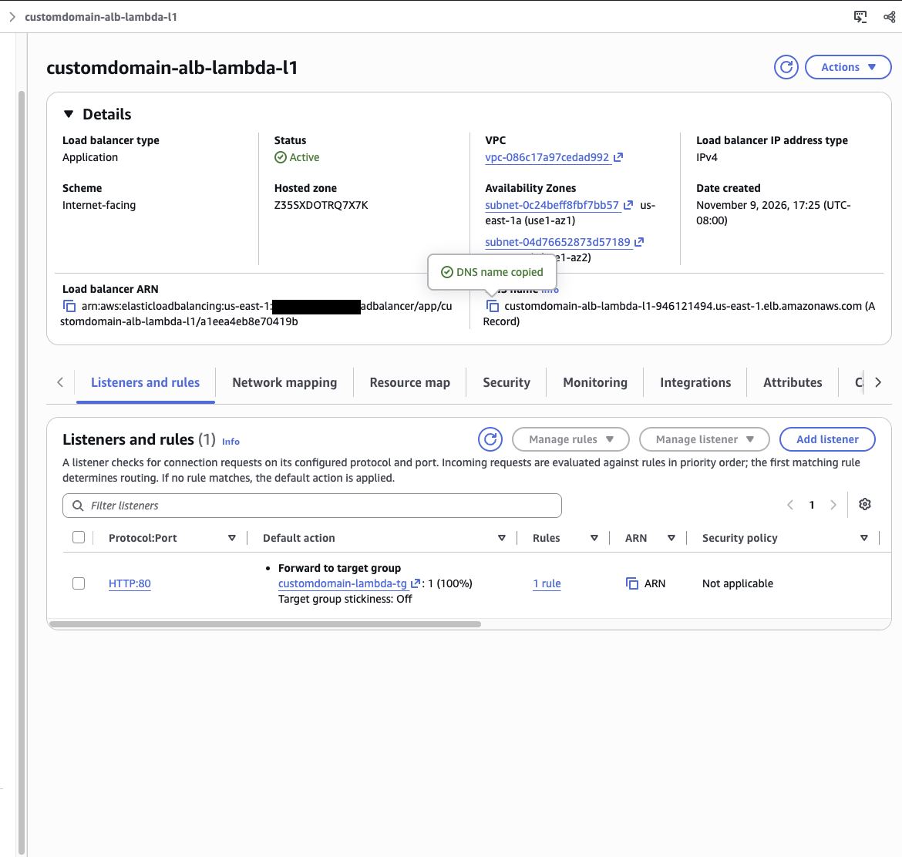

**2. Task 1: the ALB DNS name returns "Hello World from Lambda!"**
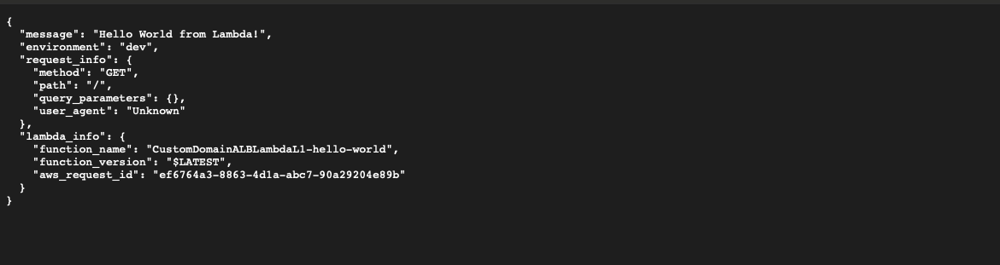

**3. The hosted zone before: only the NS and SOA records**
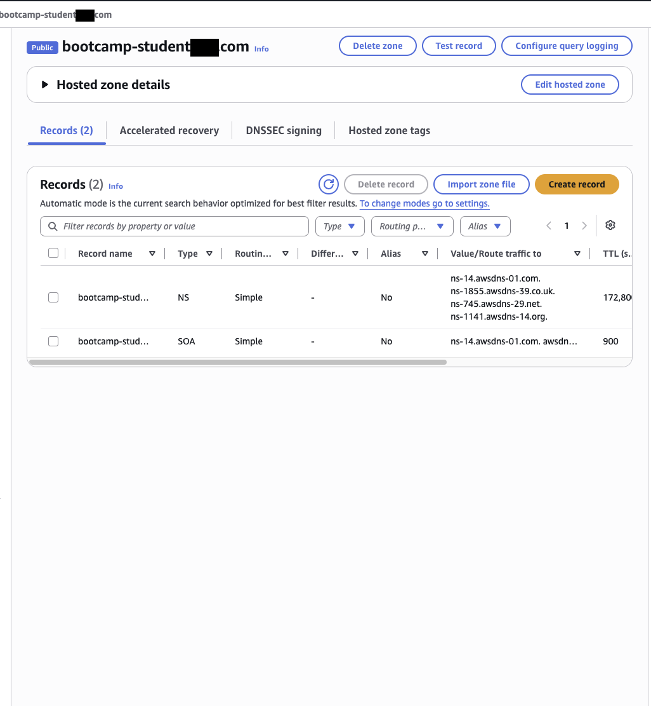

**4. Task 2: apex A record, Alias to the ALB, Simple routing**
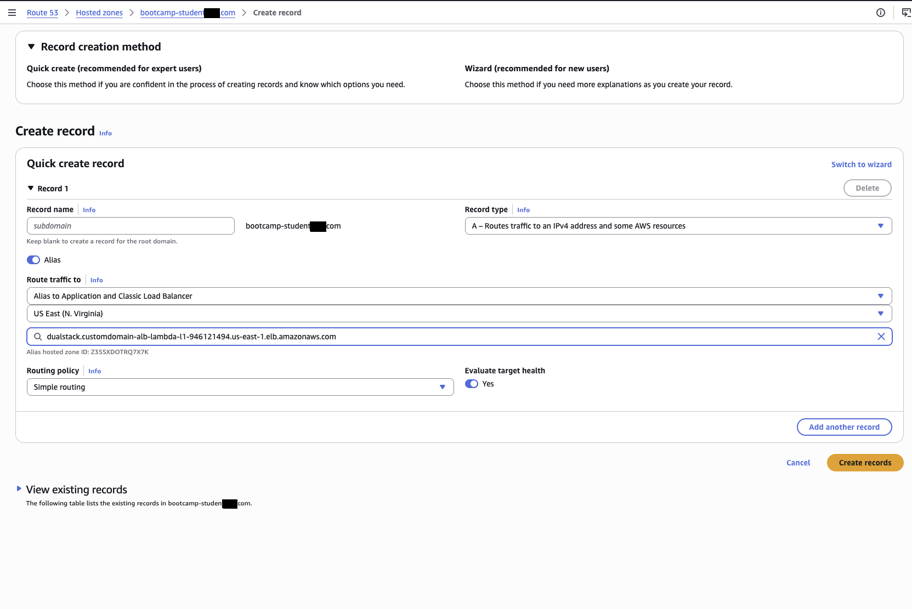

**5. The change is submitted with status PENDING**
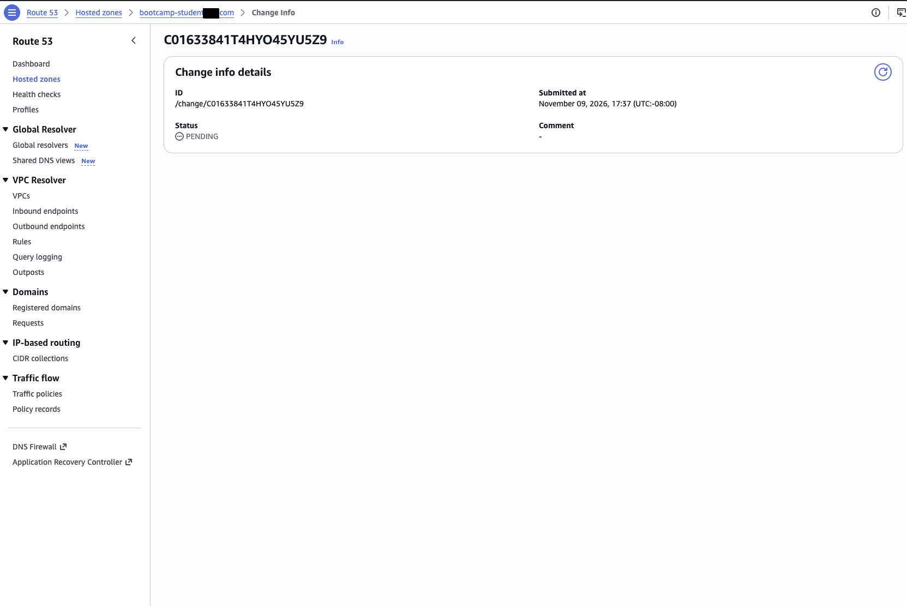

**6. The hosted zone after: the new A record (Alias = Yes, no TTL of its own)**
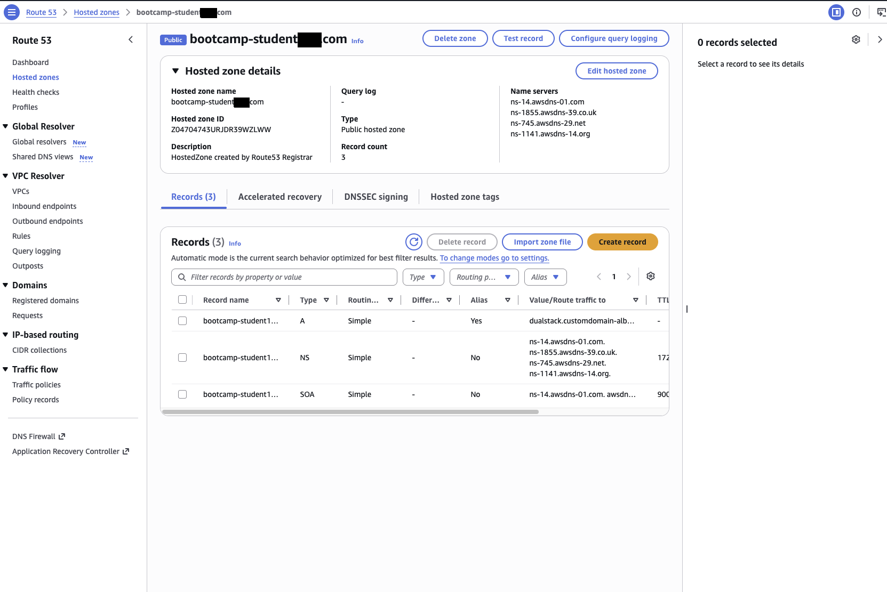

**7. Task 4: the custom domain in a browser returns the same Lambda response**
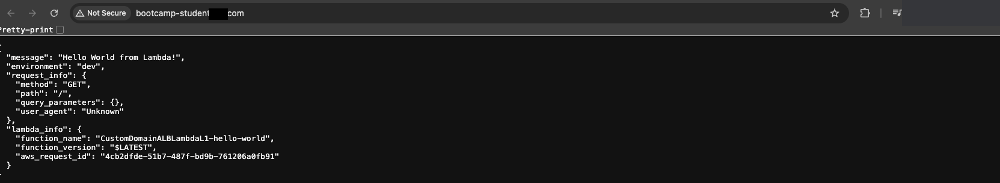

**8. Task 3 gotcha: `nslookup` and `dig` aren't installed in CloudShell**
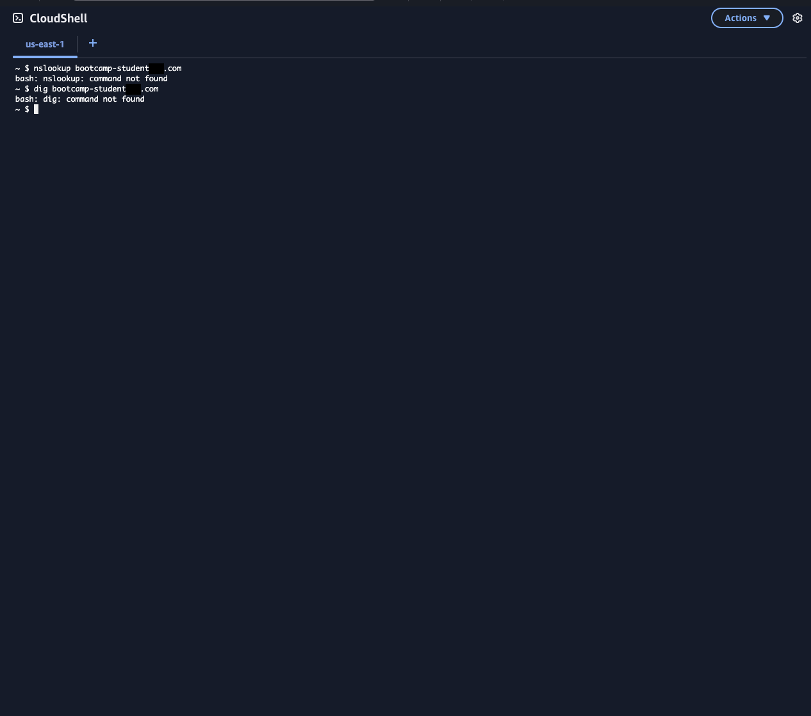

**9. The fix: `sudo dnf install -y bind-utils`**
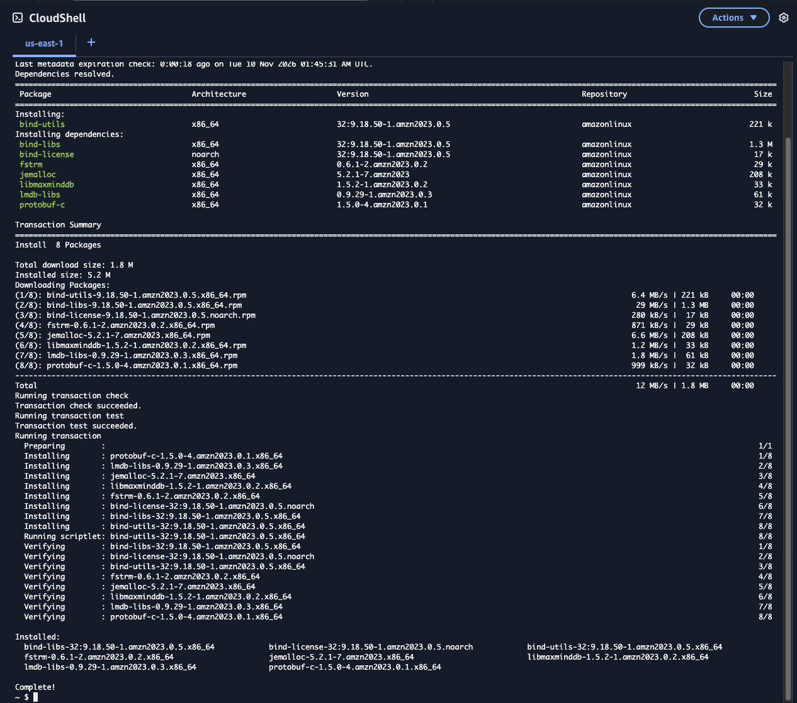

**10. `nslookup` and `dig`: two A records, TTL 59**
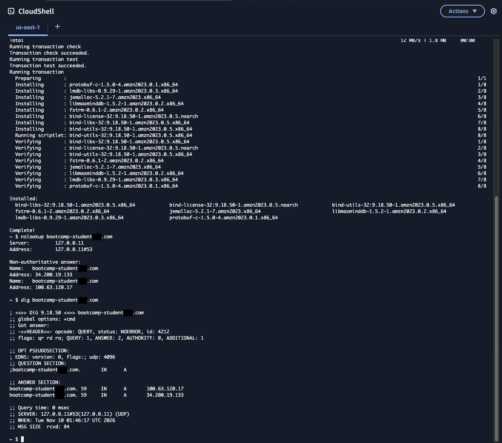

**11. `curl` to the custom domain**
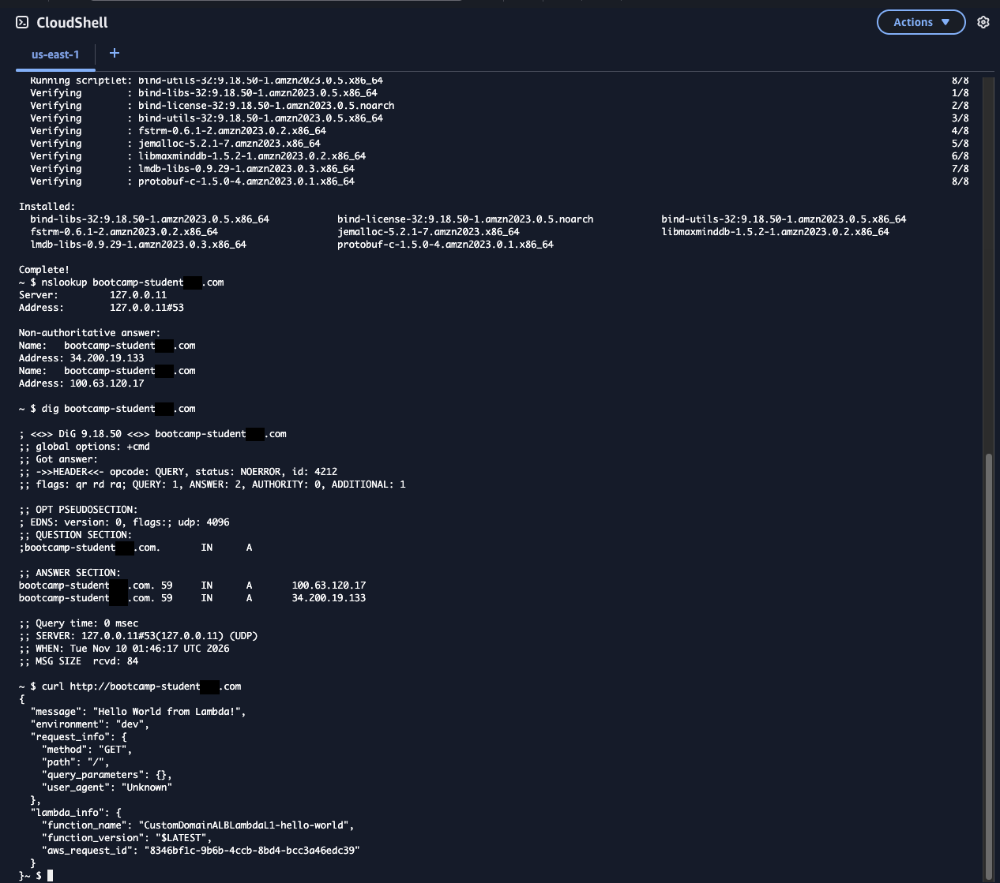

**12. Task 5: the Host header rule, priority 1**
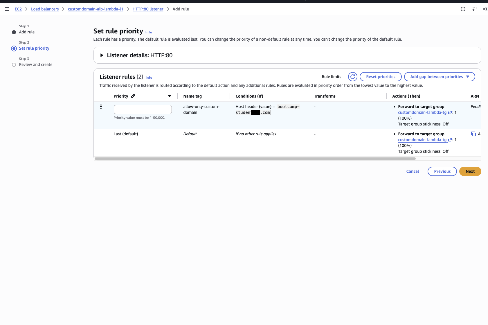

**13. Review before creating the rule**
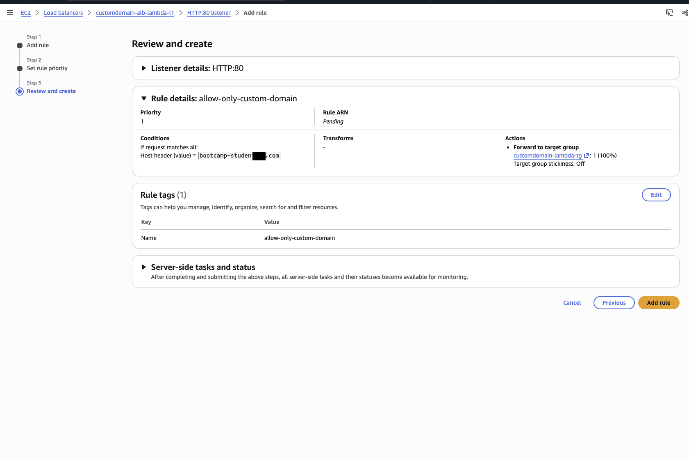

**14. The listener after: rule 1 forwards the domain, the default rule returns 403 (account ID redacted)**
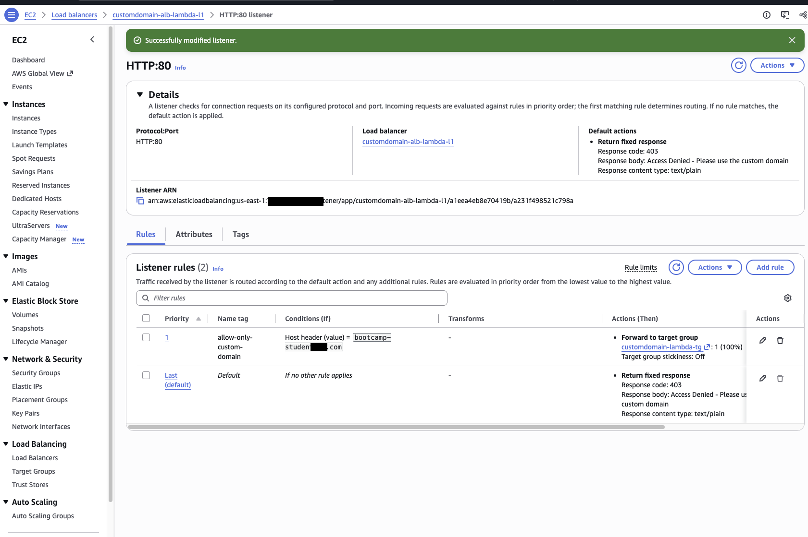

**15. Final test: the domain works, the ALB DNS name gets 403 Forbidden from `awselb/2.0`**
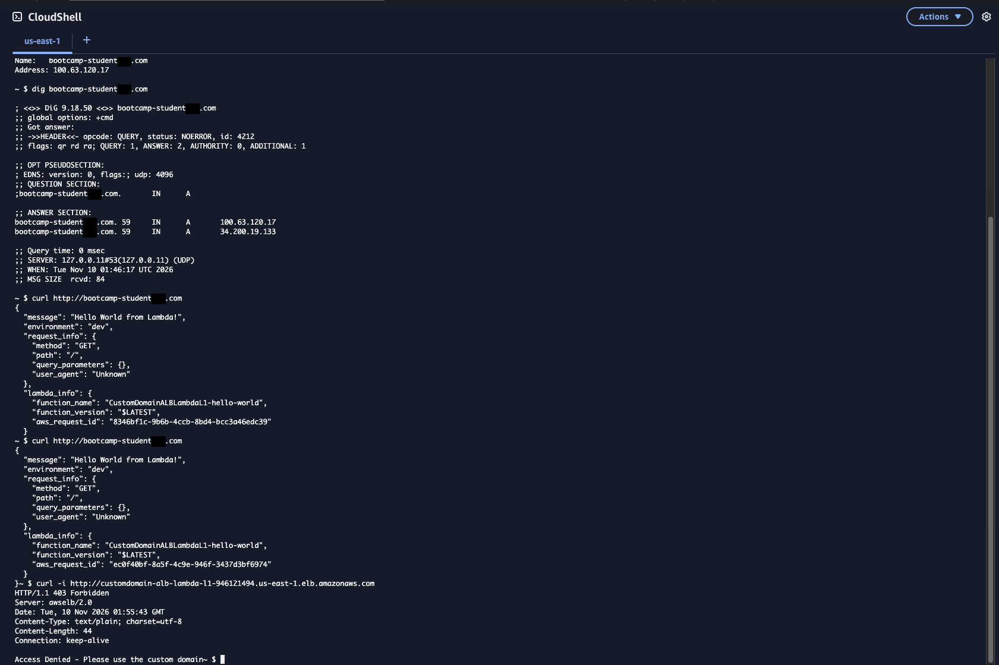

## Well-Architected pillars
- **Security:** with the Host header rule, nobody can reach the app through the raw ALB address. That matters once a WAF or CloudFront sits in front of the domain, because a direct ALB request would skip them. (A Host header can be spoofed, so for real protection pair it with a security group that only allows CloudFront, or a secret header that CloudFront adds.)
- **Reliability:** an alias record follows the ALB's IP addresses as they change, and the ALB has a node in each AZ, so DNS always hands out working addresses. Route 53 failover routing with health checks extends this to a second Region.
- **Operational Excellence:** one public name instead of an AWS-generated one, so the backend can be replaced without telling users. All traffic arriving on one host name also keeps logs and analytics in one place.
- **Cost Optimization:** Route 53 doesn't charge for alias queries to AWS resources such as an ALB, while CNAME queries are billed. The 403 is answered by the ALB, so blocked requests never invoke (or bill) the Lambda function.

## What I learned
- **Alias, not CNAME, at the apex.** DNS doesn't allow a CNAME at the root of a zone (`bootcamp-student[X].com` itself), so the only way to point the bare domain at an ALB is a Route 53 alias A record. It also tracks the ALB's changing IPs and is free to query.
- **An alias has no TTL of its own.** The hosted zone shows TTL "-" for the record, but `dig` returned TTL 59: Route 53 uses the TTL of the ALB's own DNS record (60 seconds), counting down in the resolver's cache.
- **Two IP addresses = two Availability Zones.** The ALB runs a node in each AZ it's enabled in, and DNS returns all of them.
- **"dualstack." is added for you.** The console fills in `dualstack.<ALB DNS name>`, the ALB name that answers both IPv4 and IPv6, and the alias hosted zone ID matches the one on the ALB's details page.
- **CloudShell doesn't ship with `dig`.** The lab says to run `nslookup` and `dig` but not where. CloudShell is Amazon Linux 2023 without `bind-utils`, so it needs `sudo dnf install -y bind-utils` first.
- **Host header, not HTTP header.** In the rule's condition list I first picked *HTTP header* and typed `Host`, but ALB doesn't let you match Host that way. The right condition type is *Host header*.
- **The default rule is edited from the listener, not the rules list.** In the current console, the default action is changed with **Edit listener**, not by editing a rule.
- **`Server: awselb/2.0` tells you who answered.** The 403 came from the load balancer, so Lambda never ran. Checking response headers with `curl -i` is a quick way to tell an ALB error from an application error.
- **`user_agent` was always "Unknown".** Even `curl` sends a User-Agent, so the Lambda code probably looks the header up with the wrong case: ALB passes header names to Lambda in lowercase (`user-agent`). I didn't see the function code, so that's my best guess.
- **ALBs are regional, Route 53 is global.** One ALB can't send traffic to another Region. To serve users from several Regions, you put an ALB in each and let Route 53 choose with latency or failover routing.
