# Database and Server Migration with DMS and MGN

> **Status: in progress (paused).** The database migration is done. The web server is replicated to AWS and ready for testing, but the test launch is blocked by a Free Tier restriction on my account, so testing and cutover haven't happened yet. Details are under [Status and next steps](#status-and-next-steps).

### Objective
Rehost a two-server WordPress application in AWS: move its MySQL database to Amazon RDS with **AWS Database Migration Service (DMS)**, and move the web server to EC2 with **AWS Application Migration Service (MGN)**, using continuous replication so the cutover window stays short.

### What I did
I followed the AWS workshop *Application Migration with AWS* in my own account (us-west-2). A CloudFormation stack, `ApplicationMigrationWorkshop`, built a "source" environment that stands in for an on-premises data center: a MySQL server (`Source-DBServer`, t3.micro) and a WordPress web server on Ubuntu (`Source-Webserver`, t3.small, two disks of 16 and 8 GiB), plus a target VPC.

For the **database**, I created a target RDS MySQL instance, a DMS replication instance and two endpoints, turned on binary logging on the source, and ran a **full load + CDC** task. All 28 WordPress tables loaded and the task moved on to ongoing replication.

For the **web server**, I initialized MGN, configured its replication and post-launch templates, installed the AWS Replication Agent over Session Manager, and waited for the initial sync of all 24 GiB. The server reached **Ready for testing** with replication **Healthy**. I then customized how the migrated server would launch (CloudWatch agent, right sizing off, a new launch template version on t3.micro). The test launch failed with a Free Tier error, which is where the project stands. Afterwards I deleted every resource to stop charges.

### Services I learned
- **AWS Database Migration Service (DMS)**: replication instances, subnet groups, source and target endpoints, full load + change data capture (CDC) tasks, table statistics
- **Amazon RDS for MySQL** as the migration target
- **AWS Application Migration Service (MGN)**: replication agent, replication and launch templates, post-launch actions, migration lifecycle, launch jobs
- **Amazon EC2**: launch templates and versions, security groups, instance profiles, user data
- **AWS Systems Manager**: Session Manager for shell access without SSH, Parameter Store for the CloudWatch agent config
- **AWS CloudFormation**: deploying and cleaning up the workshop environment, and a stack delete that failed

## Architecture
```
 "On-premises" (source VPC)                         AWS target (TargetVPC, us-west-2)
 ─────────────────────────                          ──────────────────────────────────
 Source-DBServer (MySQL, binlog ON)
        │  full load + CDC
        └──────────────► DMS replication instance (dms.t3.medium) ──────► RDS MySQL database-1 (db.t3.micro)
                         source-endpoint → task replication-cdc → target-endpoint

 Source-Webserver (WordPress, Ubuntu, 16 + 8 GiB)
   AWS Replication Agent
        │  block-level replication over TCP 443 / 1500
        └──────────────► MGN replication server (t3.small, staging subnet TargetVPC-public-a)
                                │  EBS volumes + snapshots
                                ▼
                         Test / cutover instance from launch template v3   ◄── blocked here
                         (t3.micro, MigratedWebServer-SG: HTTP from anywhere, public IP)
                                │  planned: point wp-config.php at the RDS endpoint
                                ▼
                         RDS MySQL database-1
```

## Result

| Part | Where it got to |
|---|---|
| Database (DMS) | **Done.** Task `replication-cdc` at 100%, status *Load complete, replication ongoing*. All 28 `wordpress-db` tables show *Table completed* (for example `wp_postmeta` 35,291 rows, `wp_term_relationships` 2,012 rows). |
| Web server replication (MGN) | **Done.** 24 of 24 GiB replicated, *Initial replication finished*, 52 minutes of elapsed replication time. Lifecycle *Ready for testing*, data replication *Healthy*. |
| Launch customization | **Done.** CloudWatch agent post-launch action active, right sizing off, launch template version 3 set as default. |
| Test launch | **Failed:** `InvalidParameterCombination`, instance type not eligible for Free Tier. |
| Cutover and WordPress reconfiguration | **Not started.** |
| Cleanup | **Done.** All workshop resources deleted. |

## Steps completed

### Part 1: Database with DMS
1. **Target database:** created RDS MySQL `database-1` (db.t3.micro) in the target VPC.
2. **Replication instance:** DMS replication instance (dms.t3.medium) with subnet group `dms-subnet-group` and security groups `RI-SG` and `DB-SG`.
3. **Endpoints:** `source-endpoint` (the MySQL server) and `target-endpoint` (RDS).
4. **Binary logging on the source:** CDC reads changes from the MySQL binary log, so it had to be enabled before the task could replicate ongoing changes.
5. **Task:** `replication-cdc`, migration type **full load + ongoing replication**. Table statistics showed all 28 tables completed, and the task kept running to pick up new changes.

### Part 2: Web server with MGN
1. **Initialize MGN** (now in the console as *AWS Transform MGN*), which creates the default replication, launch and post-launch templates.
2. **Replication template:** staging area subnet set to `TargetVPC-public-a`. The replication server type stayed t3.small.
3. **Post-launch template:** activated post-launch actions with the **SSM agent** action, for test and cutover instances.
4. **Install the agent:** connected to `Source-Webserver` with **Session Manager**, downloaded `aws-replication-installer-init.py` from the us-west-2 MGN bucket, and ran it with `sudo python3`. The server appeared in MGN as `ip-10-0-0-51`.
5. **Initial sync:** 24 GiB (both disks) replicated. The lifecycle moved from *Not ready* to *Ready for testing* and replication showed *Healthy*.
6. **Post-launch CloudWatch agent:** created the Parameter Store parameter `cloudwatch-config` and activated the **CloudWatch agent installation** action on the server.
7. **Launch settings:** turned **Instance type right sizing Off**, so MGN uses the instance type from the launch template instead of picking one from the source server's size. (The default template had c5.large.)
8. **EC2 launch template, version 3 (set as default):** t3.micro, subnet `TargetVPC-public-a`, a new security group `MigratedWebServer-SG` allowing HTTP from 0.0.0.0/0, auto-assigned public IP, Name tag `Webserver`, instance profile `ApplicationMigrationWorkshop-EC2InstanceProfile`, and user data `apt remove -y unattended-upgrades` (so automatic updates don't lock apt on first boot).
9. **Launch test instance:** the job started and the lifecycle moved to *Test in progress*, then the launch failed (see below).

## Troubleshooting and surprises
- **The test launch failed on Free Tier.** The launch job failed in the conversion step with:
  ```
  An error occurred (InvalidParameterCombination) when calling the RunInstances operation:
  The specified instance type is not eligible for Free Tier. For a list of Free Tier instance
  types, run 'describe-instance-types' with the filter 'free-tier-eligible=true'.
  ```
  My account is on the AWS **Free plan** (credits), which only allows Free Tier eligible instance types. The test instance itself was set to t3.micro, which is eligible, so my best guess is that the failing `RunInstances` call is for the temporary **conversion server** that MGN launches to make the replicated disks bootable on EC2. MGN chooses that server's type, and it isn't one I can change. I haven't confirmed this. Upgrading the account to the Paid plan should remove the restriction, but I chose to stay on the Free plan for now.
- **"Text file busy" and a port 443 error from the agent installer.** I ran the installer a second time while the first run was still going. The second run reported `Connection attempt to us-west-2 on port 443 failed` and `OSError: [Errno 26] Text file busy: 'aws-replication-installer-64bit'`. That looked like a network problem, but `ps aux | grep aws-replication` showed the agent was already installed and running (`tailer`, `update_onprem_volumes`, the Java agent, and driver scripts), and the server was already in MGN. The second run simply couldn't overwrite a file the first run was executing.
- **CloudFormation stack delete failed on the VPC.** The first delete ended in `DELETE_FAILED` on `TargetVPC`, because resources I had created outside the stack were still inside it: `dms-subnet-group` and the security groups `DB-SG`, `RI-SG`, `MigratedWebServer-SG` and two default MGN security groups. Once I deleted those, the retry succeeded.
- **An MGN source server has to be disconnected before it can be archived.** Archive was unavailable until I ran *Disconnect from service*, which stops replication and removes the agent's connection.

## Cleanup
- MGN: disconnected and archived the source server, and terminated the replication server.
- DMS: deleted the task, replication instance, both endpoints and `dms-subnet-group`.
- RDS: deleted `database-1`.
- Systems Manager: deleted the `cloudwatch-config` parameter.
- VPC: deleted the leftover security groups, then deleted the `ApplicationMigrationWorkshop` stack.
- Checked that no EBS volumes, snapshots, load balancers or Elastic IPs were left.

## Status and next steps
**Paused.** The database is fully migrated and the web server was fully replicated, but no instance was launched in AWS, so there was no test, no cutover, and WordPress was never pointed at RDS. Because everything has been deleted, finishing means redeploying the stack and repeating the steps above on a Paid plan account. The remaining steps are:
1. Launch the test instance and check that WordPress loads on its public IP.
2. Mark the server *Ready for cutover*.
3. Launch the cutover instance.
4. Edit `wp-config.php` on the migrated server so `DB_HOST` points at the RDS endpoint, and confirm the site still works.
5. Finalize cutover, which stops replication and cleans up MGN's staging resources.

## Screenshots

**1. Post-launch template saved, with the SSM agent action active**
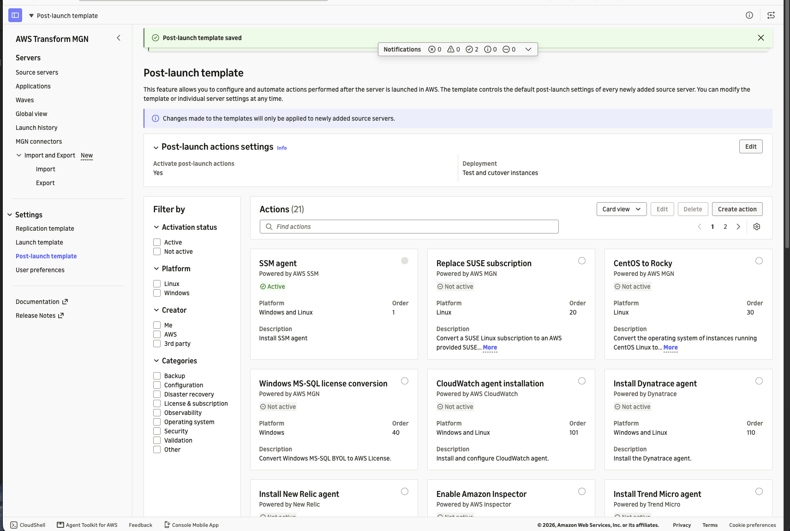

**2. The agent installer's second run fails with "Text file busy", but `ps` shows the agent already running (S3 endpoint IPs redacted)**
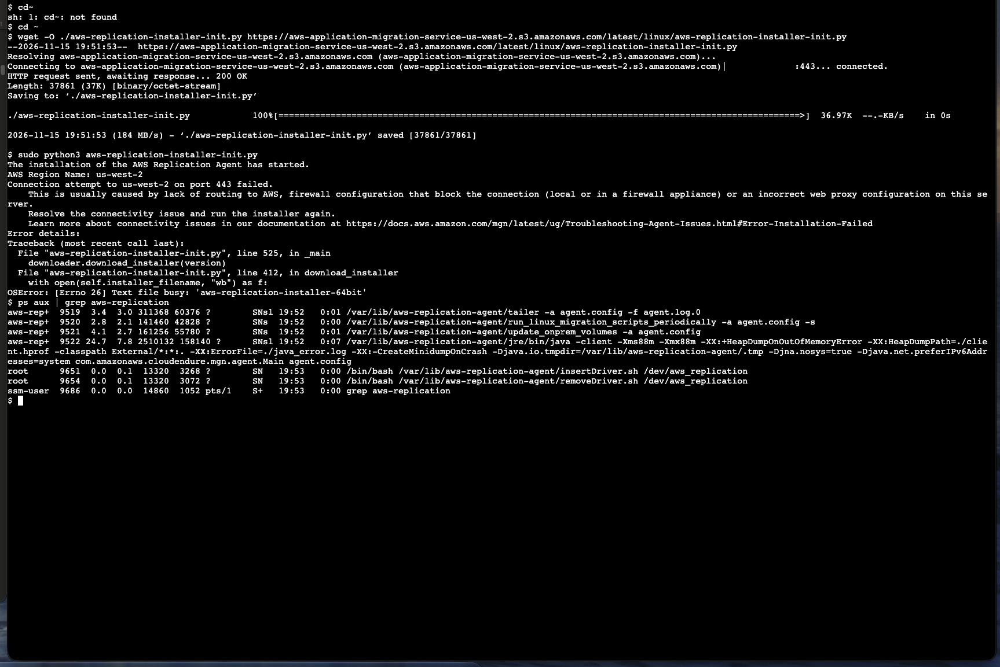

**3. Replication settings: t3.small replication server, public IPv4 for data replication (URL with account ID redacted)**
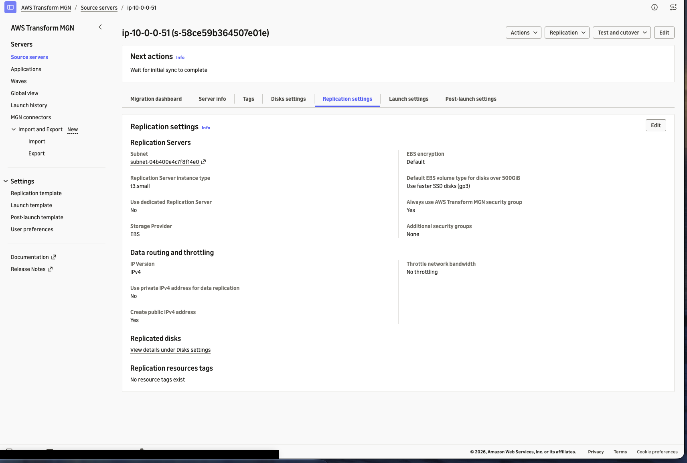

**4. Initial sync at 100%, 24 of 24 GiB, creating the first launchable snapshot**
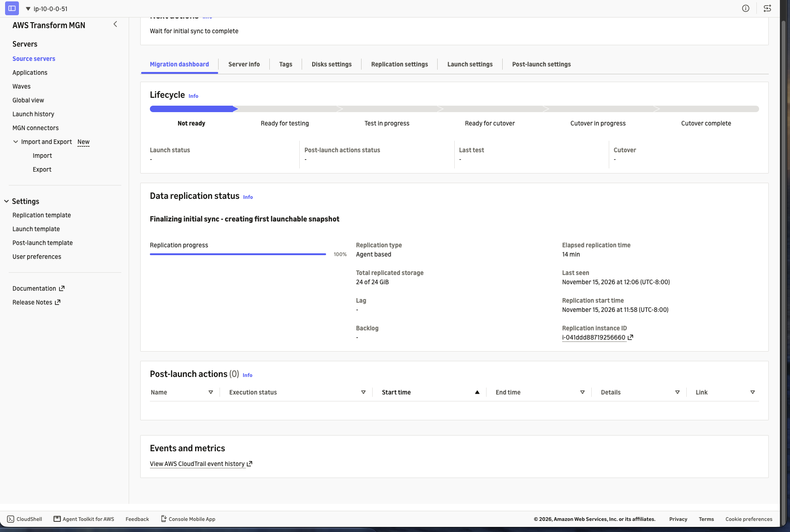

**5. Ready for testing: initial replication finished in 52 minutes, replication Healthy**
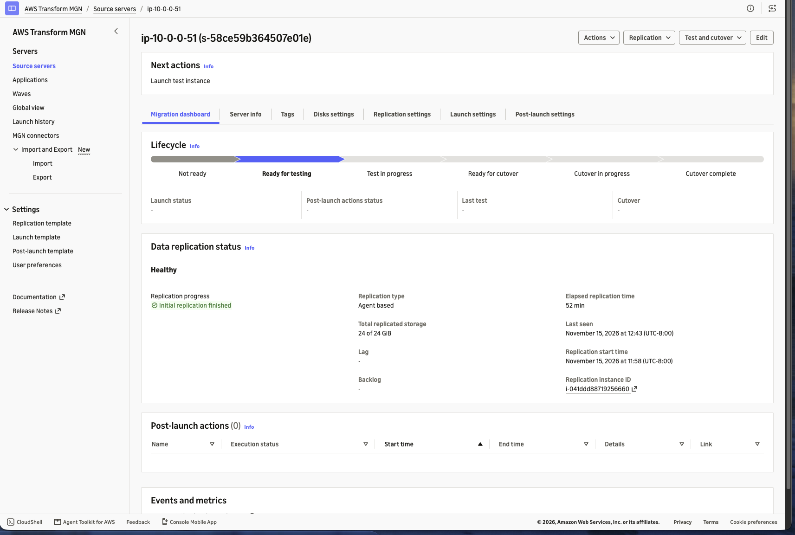

**6. CloudWatch agent installation post-launch action Active**
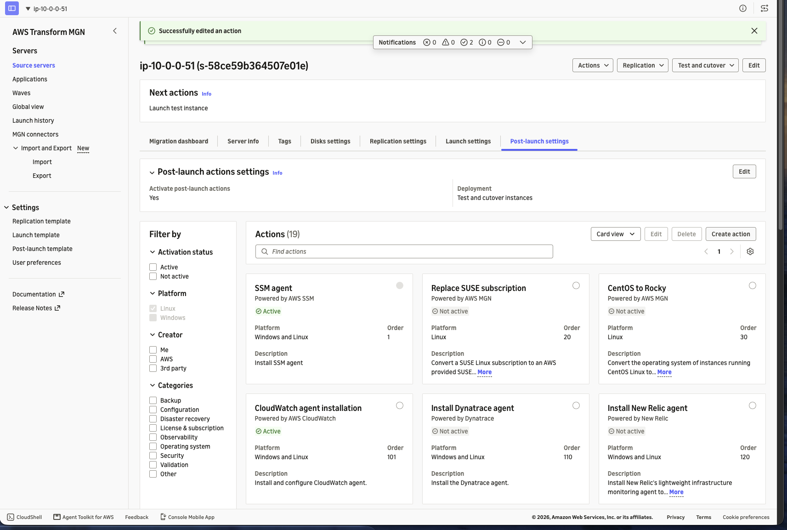

**7. Launch settings: instance type right sizing Off (the default template still shows c5.large)**
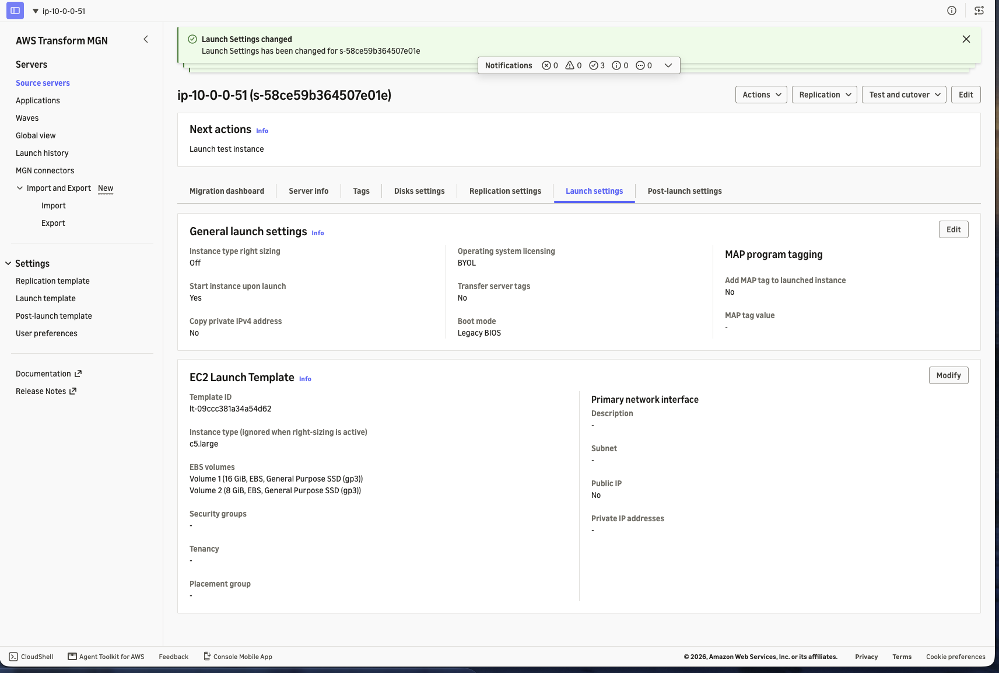

**8. EC2 launch template version 3 set as default, instance type t3.micro (account ID and ARNs redacted)**
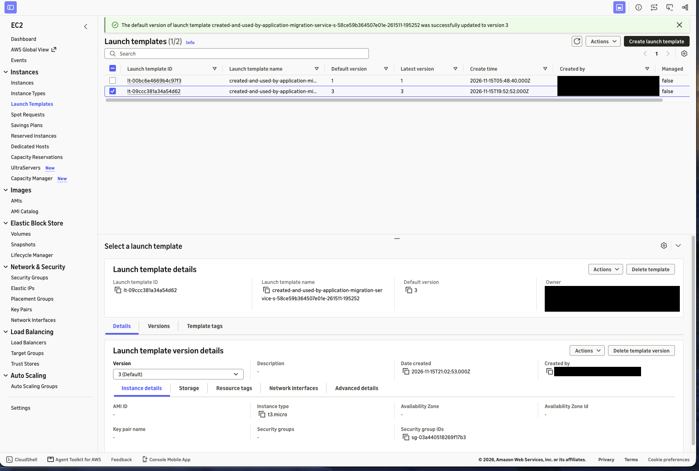

**9. Test launch job created, lifecycle Test in progress**
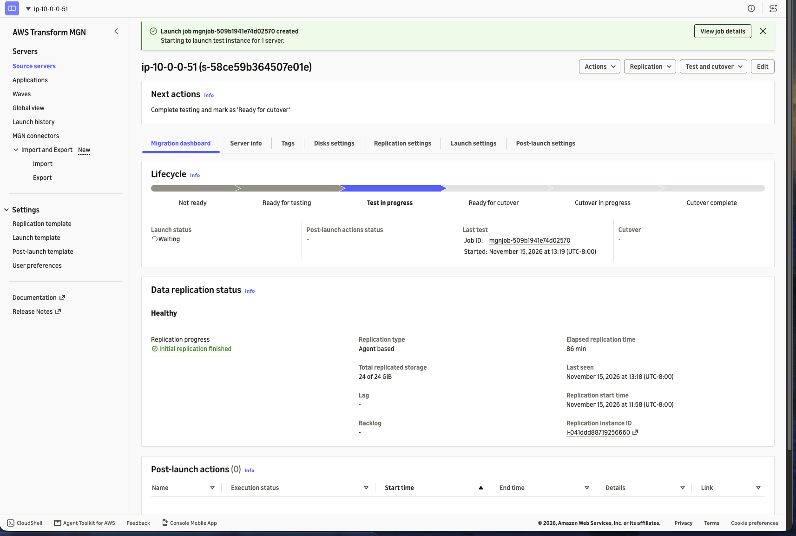

**10. Job log: RunInstances rejected because the instance type isn't Free Tier eligible, server status Failed**
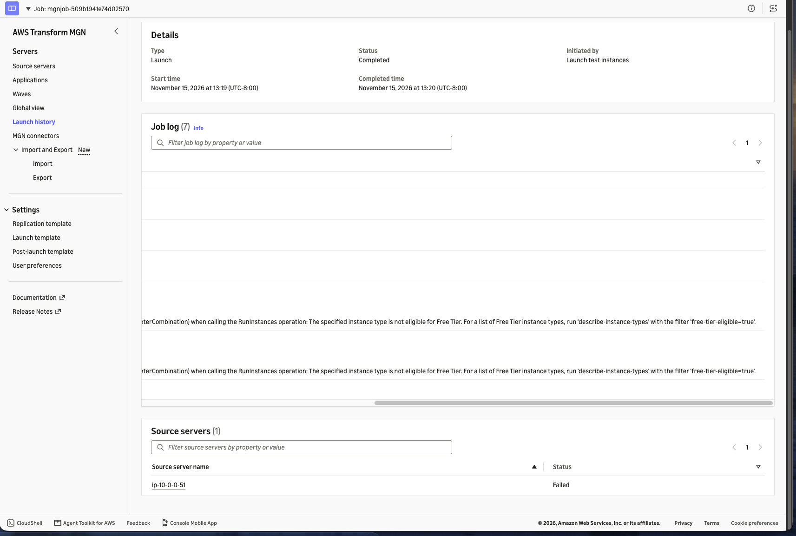

**11. Cleanup: DMS dashboard with no tasks, replication instances or endpoints**
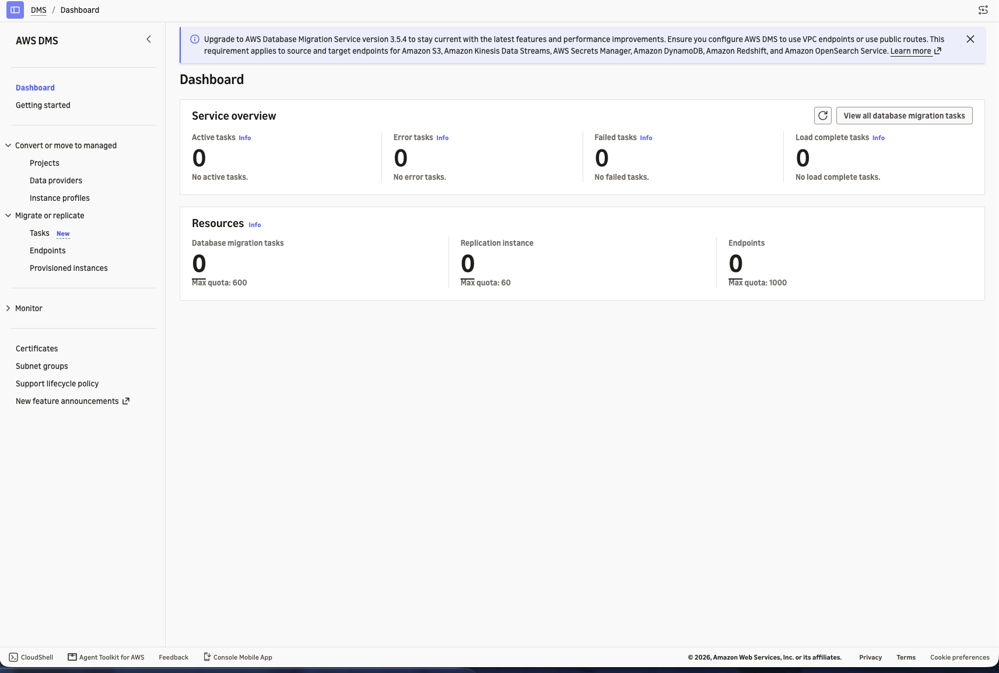

**12. Cleanup: no CloudFormation stacks left**
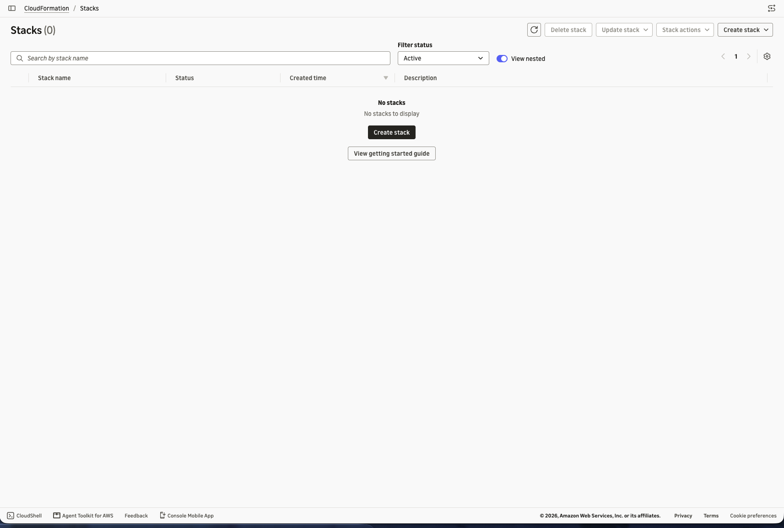

<!--
DMS screenshots still to add from the database part (not included yet):
- replication instance available
- source and target endpoints with successful connection tests
- task replication-cdc: "Load complete, replication ongoing", 100%
- table statistics: 28 tables "Table completed" (wp_postmeta 35,291 rows)
-->

## Well-Architected pillars
- **Reliability:** both tools replicate continuously, so the source keeps serving users until cutover and the final switch only has to cover the last few seconds of changes. MGN's test launch exists to prove the server boots in AWS before anything changes for users.
- **Security:** Session Manager gave shell access to the source server with no SSH key or open port 22. The DMS replication instance and the database each had their own security group (`RI-SG`, `DB-SG`). `MigratedWebServer-SG` opens HTTP to the world for the workshop, and a real migration would put the server behind a load balancer and add HTTPS.
- **Operational Excellence:** MGN's templates and post-launch actions (SSM agent, CloudWatch agent) make every migrated server come up configured the same way instead of being fixed by hand after launch.
- **Cost Optimization:** I turned off right sizing and chose t3.micro instead of the default c5.large, and deleted everything as soon as I stopped. Replication servers, DMS instances and RDS bill by the hour whether they're used or not.
- **Performance Efficiency:** right sizing is useful in a real migration, because it matches the EC2 type to the source server's CPU and RAM. I turned it off here only to control the instance type.

## What I learned
- **Full load + CDC is what makes a short cutover possible.** The full load copies the tables, then CDC keeps applying changes from the source's binary log. Without binary logging on the source, DMS can do the full load but can't replicate ongoing changes.
- **DMS moves data, not the whole database.** It loads tables and rows, but secondary indexes, users, triggers and stored procedures need separate handling (for example a schema dump or AWS SCT for different engines).
- **MGN replicates blocks, not files.** The agent copies whole disks to EBS volumes on a lightweight replication server in a staging subnet, which is why it doesn't care what applications run on the server.
- **A launch involves more than one instance.** Before the test instance starts, MGN uses a temporary conversion server to make the replicated disks bootable on EC2 (drivers, boot settings). Setting the test instance to a Free Tier type wasn't enough, which points to that hidden step.
- **Free plan accounts block non-eligible instance types at the API.** The error comes back from `RunInstances` itself, so it shows up in whatever service launched the instance, here MGN's job log, not in EC2.
- **Read the error before rerunning the installer.** The port 443 message suggested a network problem, but `ps` showed the first run had worked. Checking the actual state of the server saved me from troubleshooting the wrong thing.
- **Clean up resources you created outside the stack first.** CloudFormation can't delete a VPC that still holds a subnet group or security groups it doesn't own, and the error only names the VPC.
